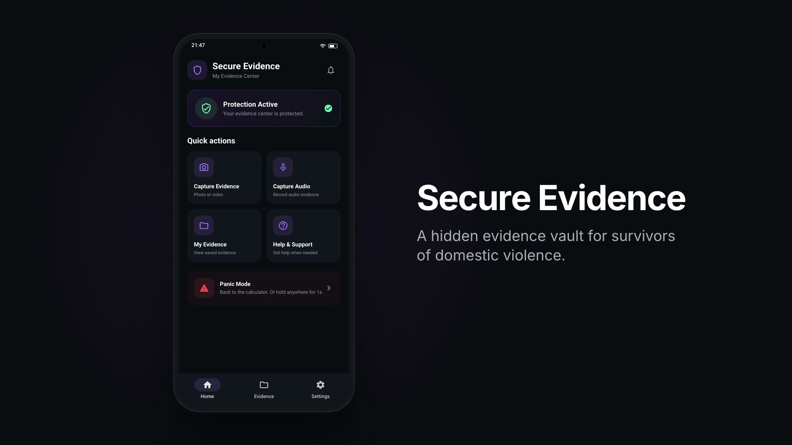

# 🛡️ Secure Evidence

### **When evidence matters, preserving it matters more.**

Secure Evidence is an Android app for survivors of domestic violence. On the phone it looks and works like an ordinary calculator. Type a secret sum and it opens a private vault where photos, video and audio are captured, encrypted on the spot, and kept out of the phone's gallery. Every capture's fingerprint is recorded on a server where nobody can change or delete it, so months later the evidence can still be shown to be exactly what was captured.

**Status:** under active development, about 95% complete. 220 app tests and 15 server-rule tests pass; the full on-device test pass is still outstanding. **[ABOUT.md](ABOUT.md)** has the story behind it, what works today, and how it all works.

---

## 🎬 Launch video

[](docs/media/launch-video.mp4)

*33 seconds: the calculator, the secret sum, capturing evidence, the four-fingerprint integrity check, a swapped file being caught, and the panic hold. The screens are rebuilt from the app's own code, with made-up data.*

---

## 🚀 Getting started

Secure Evidence is **Android only**.

### What you need

- **Flutter** with Dart 3.13 or later. The project is built and tested with Flutter 3.47.7.
- **JDK 17 or later** for the Android build. Use **JDK 21** if you will run the server-rule tests, because the Firebase emulators need it.
- **Android SDK** with platform 36. Gradle downloads anything else it needs on the first build.
- **Firebase CLI** and **FlutterFire CLI**, to connect the app to Firebase. **Node.js** too, if you will run the server-rule tests.
- **A real Android phone** is best. The app runs on an emulator, but an emulator does not exercise the phone's hardware Keystore, which protects the keys.

### 1. Clone and fetch the packages

```bash
git clone https://github.com/edith-farzana/PRJ_47-DV-Evidence-Preservation.git
cd PRJ_47-DV-Evidence-Preservation
flutter pub get
```

### 2. Connect Firebase

The Firebase configuration files, `android/app/google-services.json` and `lib/firebase_options.dart`, are deliberately **not** in this repository. Generate them:

```bash
firebase login
dart pub global activate flutterfire_cli
flutterfire configure
```

Choose the Firebase project and **Android** only. Both files are gitignored. Without them the Android build stops at the Google Services plugin.

**Using your own Firebase project?** In the Firebase console, turn on **Anonymous** sign-in and create a **Firestore** database. Then deploy the rules that make every evidence record unchangeable:

```bash
firebase deploy --only firestore:rules --project <your-project-id>
```

### 3. Run it

```bash
flutter run
```

On first launch the app asks for a 4-digit PIN (twice) and a secret unlock sequence of calculator keys, such as `7×3-1=`. The sequence must contain an operator, so ordinary arithmetic can never open it by accident. From then on the app opens as a calculator: type the sequence, then the PIN.

To build an APK to install on a phone:

```bash
flutter build apk --release
```

The APK is written to `build/app/outputs/flutter-apk/app-release.apk`. It is signed with the debug key for now, which is fine for sideloading but not for the Play Store.

> **Screenshots of the app come out black.** That is deliberate: the app blocks screenshots, screen recording and the recent-apps preview.

### 4. Run the tests

App tests:

```bash
flutter test
```

Server-rule tests, which run against the Firebase emulator:

```bash
npm --prefix test/rules ci
firebase emulators:exec --only auth,firestore,storage "npm --prefix test/rules test"
```

### Optional: encrypted cloud backup

Backing up encrypted copies of the files is built but switched off, because Firebase Storage needs a billing account. To turn it on, enable Storage, deploy `storage.rules`, and build with `--dart-define=CLOUD_BACKUP=true`.

---

## 📚 Learn more

- **[ABOUT.md](ABOUT.md)**: how the idea came about, the problem, how the app solves it, what is built and what is not, and the technical design.
- **[docs/HOW_IT_WORKS.md](docs/HOW_IT_WORKS.md)**: every flow in plain language, including what happens when someone interferes and what the app cannot defend against.
- **[DEVELOPMENT_CHECKLIST.md](DEVELOPMENT_CHECKLIST.md)**: the build plan and its history.

---

### **SECURE EVIDENCE**

*Because some evidence is too important to lose.*
